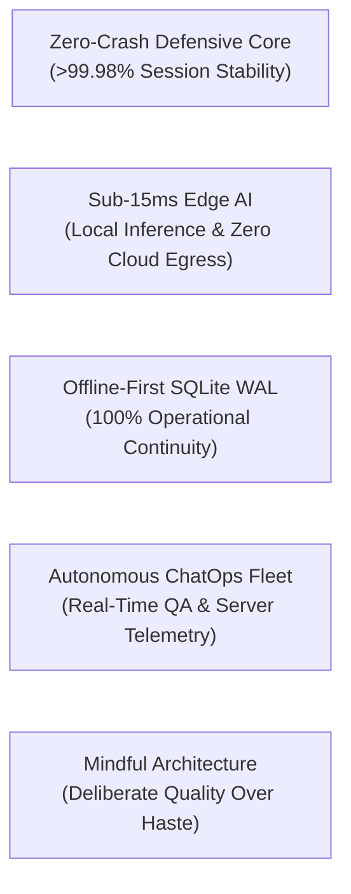

# Sharafaldain (@Brosfeer)
### Principal Mobile & Systems Software Architect | Founder of SayaSky Studio

**English** | [العربية](#الرؤية-الهندسية)

---

> *"Architecting mission-critical, ultra-low latency mobile experiences, autonomous cloud pipelines, and edge-native systems with engineering discipline, calm craftsmanship, and Dieter Rams' 'Less, but better' philosophy."*
>
> *«التميز الهندسي الحقيقي ينبع من صفاء الذهن وراحة البال؛ لا حاجة للحلول المتسرعة والترقيعية. كل فكرة تلتمع في الذهن تستحق أن تُبنى بروقان وهدوء وعمق معماري متقن لتكتمل على أصولها.»*

---

## Executive Summary & Engineering Ethos

I am **Sharafaldain (@Brosfeer)**, Principal Software & Systems Architect and founder of **SayaSky Studio**.

I engineer resilient mobile ecosystems and autonomous systems with **Clean Architecture**, on-device Edge AI, and offline-first data sovereignty. I firmly believe that the best engineering emerges from **peace of mind over haste**: every idea is given deliberate architectural incubation, ensuring right-first-time delivery without technical debt.

### Core Disciplines:
* **Mobile & Edge-Native**: 60–120 FPS high-performance Flutter & React Native / Expo, on-device PyTorch/ExecuTorch OCR, sub-pixel Bézier vector geometry, and zero audio latency.
* **Offline-First Resilience**: Defensive client-side caching (TanStack Query) paired with local SQLite WAL persistence for 100% offline continuity.
* **Autonomous DevOps & ChatOps**: Self-healing Linux host daemons, Telegram Mini Apps (TMA), and automated GitHub CI/CD triage pipelines.
* **Mindful Deliberate Pacing (Peace Over Haste)**: Rejecting reactionary, hasty patches. Systems are planned, verified empirically, and built cleanly to stand resilient for years.

---

## الرؤية الهندسية

أنا **شرف الدين (@Brosfeer)**، مهندس ومعماري البرمجيات والنظم (Principal Software & Systems Architect) ومؤسس **SayaSky Studio**.

أقود تطوير وهندسة تطبيقات الجوال والأنظمة المستقلة بالاعتماد على **المعمارية النظيفة (Clean Architecture)**، تقنيات الذكاء الاصطناعي المدمج (Edge AI)، واستقلالية البيانات بدون اتصال (Offline-First). أؤمن بأن **الجودة الحقيقية والروقان المعماري يتفوقان دائماً على التسرع والترقيع**؛ فكل فكرة جديدة تُعطى مساحتها الكافية من التفكير الهادئ والتنفيذ المتقن.

* **تطبيقات جوال فائقة الأداء**: تطوير تجارب تفاعلية بسلاسة 60-120 FPS عبر Flutter و React Native، وتكامل الذكاء الاصطناعي على الأجهزة الطرفية.
* **أنظمة تعمل بلا إنترنت (Offline-First)**: استمرارية تشغيلية 100% دون اعتماد حصري على السيرفرات عبر التخزين الذكي وقواعد بيانات SQLite WAL المحلية.
* **أتمتة البنية التحتية و ChatOps**: أدوات مراقبة خفيفة للسيرفرات، بوتات تيليجرام تفاعلية لإدارة الـ QA، وبناء ونشر سحابي مؤتمت.
* **الهدوء المعماري قبل الكود**: التحليل الدقيق وحل الحالات المعقدة مسبقاً لضمان إطلاق برمجيات متينة تعيش لسنوات دون ديون تقنية.

---

## Core Architectural Pillars

1. **Zero-Crash Defensive Core**: Offline-first caching, atomic SQLite transactions, and resilient exception barriers yielding >99.98% stability.
2. **Sub-15ms Deterministic Edge AI**: On-device AI inference, 60–120 FPS hardware-accelerated GPU pipelines, and microsecond-latency IPC.
3. **World-Class Human-Centric UI/UX**: Authentic RTL calligraphy typography, WCAG AAA accessibility, and glassmorphic micro-interactions.
4. **Autonomous Infrastructure**: Automated GitHub test gates, headless deploy daemons, and Telegram ChatOps triage.
5. **Mindful Architecture & Peaceful Craftsmanship**: Rejecting hasty temporary fixes; deliberate calm execution for sustainable systems.

---

## Flagship Systems Portfolio

### 1. 📱 Mobile & Edge AI Flagships

| Project | Role & Domain | Stack & Architecture | Verified Impact |
| :--- | :--- | :--- | :--- |
| [**Kiddy Zone Town**](https://play.google.com/store/apps/details?id=com.sayasky.kiddyzonetown&hl=ar) | Educational Gaming Suite *(Google Play)* | Flutter • Flame Engine • Naskh Bézier Splines • SoLoud Audio | 5 interactive hubs, sub-pixel letter tracing, zero audio desync, automated cloud builds. |
| [**Rakhys (راخص)**](https://apps.apple.com/sa/app/rakhys-ksa-electronics-deals/id6587583728) | Price Intelligence Engine *(App Store & Play)* | React Native / Expo • Liquid Glass DS • Sub-15ms Parser | Real-time Saudi e-commerce price comparisons (Amazon vs. Noon) with instant savings calculators. |
| **TAWLIFA (توليفة)** | Culinary Discovery Ecosystem | React Native • Express TypeScript API • Automated Scrapers | Full-stack platform: multi-source recipe intelligence, offline persistence, and microservices backend. |
| **Hisabi (حسابي)** | Edge-AI Fintech & Receipt OCR | React Native • PyTorch ExecuTorch • Encrypted SQLite WAL | Sub-15ms on-device receipt scanning & VAT calculations with 100% privacy and zero cloud egress. |

---

### 2. ⚡ Autonomous Infrastructure & ChatOps Fleet

| System | Role & Domain | Architecture | Impact |
| :--- | :--- | :--- | :--- |
| **PulseGuard 2.0** | Server Telemetry & Health WebApp | Telegram Mini App (TMA) • HMAC-SHA256 • SQLite Ring Buffer | Ultra-lightweight host daemon (<0.2% CPU overhead) delivering instant resource push alerts. |
| **Telegram AI Issue Fleet** | ChatOps QA & GitHub Automation Hub | Python 3.12 • Python-Telegram-Bot • GitHub CLI (`gh`) | Mobile screenshot QA triage with automated GitHub Sub-Issue and label generation directly from chat. |
| **Saya Core (`saya-core`)** | Distributed AI Memory & Workflow Protocol | Cross-Device Sync (`saya-sync`) • Markdown Knowledge Base | Unified memory, architectural standards, and anti-fatigue collaboration across dev servers and laptops. |
| **Tech Notes Hub** | Architectural Knowledge Base | Markdown Documentation • Stack-specific Best Practices | Authoritative guides covering React Native, Next.js, and Python production patterns. |

---

## Technology Stack

### Mobile & Cross-Platform

### Languages & Core Systems

### Web, Cloud & Autonomous DevOps

### Mobile Infrastructure & Resilience

---

## Connect & Collaborate

- **GitHub Profile**: [@Brosfeer](https://github.com/Brosfeer)
- **Official Google Play Studio**: [SayaSky Studio](https://play.google.com/store/apps/details?id=com.sayasky.kiddyzonetown&hl=ar)
- **Telegram Direct**: [@sharafaldain](https://t.me/sharafaldain)
- **Ecosystem Repositories**: [40+ Active Repositories](https://github.com/Brosfeer?tab=repositories)

---

  Built with engineering precision, calm craftsmanship & architectural clarity by <b>Sharafaldain (@Brosfeer)</b>.

